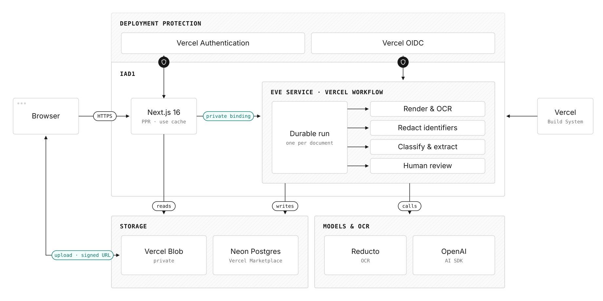

# Architecture

Clinical record ingestion: a clinician uploads a scanned or digital record, the system reads it, redacts direct identifiers, links it to a patient, extracts observations, indexes doctor notes, and hands the result to a person for review. Terms are defined in [`CONTEXT.md`](../CONTEXT.md); decisions with real trade-offs are in [`docs/adr`](adr).

## Principles

1. **Evals drive the work.** Every model-backed stage gets a dataset and scorers before its prompt is written. See [Evaluation](#evaluation).
2. **Fail closed on privacy.** Third parties other than the OCR model never see unconfirmed identifiers. The protected viewer temporarily shows unredacted renders only while status is `reading` or `redacting`, through single-file signed URLs valid for 15 minutes. Published pages burn only `applied` and `accepted` redactions; `needsReview` candidates remain visible with outlines until a reviewer decides.
3. **Everything cites its source.** Observations, redactions and note chunks carry page, block ID and box, so the UI can outline them and reviewers can verify them.
4. **Deterministic pipeline, agents only where judgment helps.** The pipeline is a durable workflow. The two agents (observation review and chart Q&A) use narrow tools.
5. **Replay-safe writes.** Deterministic IDs and upserts, so a retried step never duplicates data.

## Packages

| Package            | Responsibility                                                                                                                 |
| ------------------ | ------------------------------------------------------------------------------------------------------------------------------ |
| `apps/web`         | Next.js document API gateway; validates requests and calls the authenticated eve service                                       |
| `packages/ai`      | eve service, ingestion workflow and steps, plain rendering stage, model instances, Blob artifacts and contracts                |
| `packages/db`      | Drizzle schema and migrations for Neon Postgres with pgvector                                                                  |
| `packages/storage` | Provider-agnostic wrapper over Vercel Blob: put, get, head, list, delete, client upload tokens, signed read URLs. No app logic |
| `packages/logger`  | Shared tslog root and named children: pretty locally, JSON on Vercel/production, sensitive keys masked                         |
| `packages/ui`      | shadcn components on Base UI                                                                                                   |

`packages/ai` owns everything document-specific about storage: the artifact path layout, AES-256-GCM encryption of review-only artifacts, and their deletion.

## Services

| Service                          | Use                                                                                                      |
| -------------------------------- | -------------------------------------------------------------------------------------------------------- |
| OpenAI (direct, AI SDK provider) | Picture pass, classification, demographics, PII detection, extraction, agents, embeddings                |
| Reducto parse (`r-1`)            | OCR: page text, layout blocks and word boxes, chosen by the OCR evaluation and re-evaluated over time    |
| Tesseract (WASM, in-process)     | Character boxes inside regions that hold identifiers, for exact redaction geometry                       |
| AWS Comprehend Medical           | Clinical entity enrichment of redacted note text, behind an `Enricher` interface                         |
| Vercel Workflow (via eve)        | Durable pipeline run and review loop                                                                     |
| Vercel Blob (private)            | Originals, page renders, OCR artifacts                                                                   |
| Neon Postgres + pgvector         | Application data and note embeddings                                                                     |
| Braintrust                       | Datasets, experiments and scores for evals                                                               |
| Vercel Deployment Protection     | Access control: Vercel Authentication on all deployments plus a shareable link. The app has no auth code |

AI Gateway is deferred; models are called directly. Model IDs live in one registry in `packages/ai`: `gpt-6.1-sol` for OCR, PII, extraction and agents, `gpt-6-luna` for classification and consent summaries, `text-embedding-3-small` for notes.

## System diagram

One Vercel deployment runs two services from root `vercel.ts`: the Next.js `web` service and the `eve` service that owns the durable workflow. `web` reaches `eve` only through a private service binding.

<picture>
  <source media="(prefers-color-scheme: dark)" srcset="diagrams/system-dark.svg">
  
</picture>

Consent documents skip extraction and other documents end as unsupported after redaction. Signed Blob URLs are issued per request on the server and never cached.

## Web rendering and cache boundaries

Next.js Cache Components and Partial Prefetching prerender the workspace shell,
sample card, document heading and upload zone. Suspense streams live counts,
document rows, review artifacts and patient profiles into matching skeletons.
The shell, statistics, document rows and patient trends render on the server;
client leaves own navigation state, filters, uploads and review interactions.

Document lists and patient counts stay live because eve writes asynchronously.
Terminal document artifacts and patient profiles with only terminal linked
documents use tagged `use cache` entries with `cacheLife('max')`. A live read
of document status, patient demographics and membership selects the entry;
processing, review and failed records bypass it. Upload, review and reset
handlers expire document and patient tags with `revalidateTag(..., { expire: 0 })`.
Signed Blob URLs are created per request outside caches. The browser retains
full-image and thumbnail URLs by Blob pathname for ten minutes, then accepts
fresh signatures on the next refresh. New page versions replace them immediately.
Only the visible documents list or a processing document's own review route polls.

## Pipeline

Each document gets one eve workflow run. The browser calls Next.js `/api/documents`, which validates the request and calls eve over a private Vercel service binding (`PIPELINE_SERVICE_ORIGIN`, 15-second timeout). The eve channel `/pipeline/documents` has no public route. It authenticates with HTTP Basic locally and Vercel OIDC on deployments, then starts, reads or resumes runs. Unknown errors return 503.

The workflow (`src/workflows/ingest-document`) runs durable steps that call plain stage functions under `src/stages`. Steps keep document content out of workflow history: they pass IDs and counts, encrypt OCR and identifier spans with `DOCUMENT_ENCRYPTION_KEY` (AES-256-GCM), and log metadata only. Row writes use UUID v5 IDs derived from the document and source, so retries replace rows instead of duplicating them.

```
upload ─► render ─► OCR ─┬─► classify ─────┐
                         ├─► demographics ─┼─► redact ─► observations ─► note index ─► review
                         └─► PII detection ┘
```

1. **Upload.** The browser uploads up to 10 PDF, PNG or JPEG files (20 MB each) straight to private Blob, three at a time. Each file becomes its own document and run. Uploading from a patient page fixes the patient.
2. **Render.** pdfium (WASM) renders PDF pages; Sharp applies EXIF orientation to images. The viewer shows these unredacted renders only while the status is `reading` or `redacting`.
3. **OCR.** Reducto returns typed blocks with boxes, reading order, cross-page `continues` links and word boxes. The result is stored encrypted ([ADR 0003](adr/0003-ocr-output-as-blob-artifacts.md)); providers are compared in [evals](evals.md).
4. **Classify, demographics and PII detection** run in parallel.
   - Classification sets the class: clinical, consent (with a summary) or other.
   - Demographics hashes identifiers inside the step and links the patient. An MRN, or last name, first name and date of birth, is a strong match; a partial match links with an identity mismatch; no match proposes a new patient.
   - PII detection finds identifier spans down to part of a token, so in `01/15/1985` only `01/15` is redacted ([ADR 0002](adr/0002-redact-direct-identifiers-keep-clinical-dates.md)). A picture pass classifies each figure (patient photo, other face, signature, logo, medical image) and finds identifiers printed inside it.
5. **Redact.** Tesseract reads each identifier region and returns character boxes; a redaction covers those characters with at most one pixel of padding. Reducto boxes are axis-aligned, so the angle comes from Tesseract baselines or the page skew. Low-confidence, unclear-picture and fallback-geometry candidates stay `needsReview` and are outlined, not burned. Burned pages are checkpointed encrypted before publication so retries survive render cleanup.
6. **Observations.** Clinical documents move to `extracting`. Extraction reads identifier-masked OCR and records labs, vitals, symptoms, adverse events, medical history and medications. Names stay as printed; vitals carry LOINC codes, and blood pressure is one panel with systolic and diastolic components ([ADR 0005](adr/0005-vitals-as-printed-with-loinc-codes.md)). Repeats within a document are merged, preferring tables over lists over narrative, and confidence below 0.7 is flagged. Each observation's box covers its row or its label and value, drawn as a rotated polygon on skewed pages.
7. **Note index.** Clinical and consent notes are masked, chunked by section and embedded with `text-embedding-3-small` into `note_chunks` ([ADR 0004](adr/0004-section-aware-note-chunking.md)). Chunks covered by a non-identifier redaction are hidden from search.
8. **Review.** The run registers its review hook, sets `needsReview` (consent documents skip extraction; other documents end as `unsupported`) and applies each action with `applyReviewAction`. Marking the document reviewed or discarding it ends the run and deletes originals and transient artifacts, keeping only the published redacted pages.

Published pages are versioned WebP pairs (`pages/<page>-v<version>.webp` and a thumbnail). Publishing writes every pair, bumps `documents.page_version`, then deletes older pages and renders, one publication at a time per document. The server signs 15-minute, single-file URLs so the browser loads pages straight from private Blob; OCR is never served.

## Review

After processing, the run waits on a single review hook in a loop. The UI resumes it with typed actions: `redaction.update`, `observation.resolve`, `patient.link`, `discard`, `markReviewed`. Each action writes a review event and runs one idempotent refresh step.

- **Approved redaction.** Acceptance republishes every page from the encrypted review sources, burning only applied and accepted redactions before recording the decision.
- **Rejected candidate.** The page is republished from the encrypted review source with only applied and accepted masks before recording the decision. Observation and note suppression IDs for the rejected redaction are cleared. Note text retains identifier masking.
- **Mark as reviewed** is enabled when nothing blocks it: no flagged or unchecked observations, no redactions needing review, no identity mismatch. It creates the patient if needed, locks the document, and deletes the review-only artifacts.
- **Discard** (duplicate upload, wrong patient) deletes the review-only artifacts and the document's derived data.

Implemented ingestion statuses: `rendering` → `reading` → `redacting` → (`extracting` →) `needsReview`, or `unsupported`; failures write `failed`, and terminal review writes `reviewed` or `discarded`.

## Privacy

- All document content is PHI. Logs and traces carry IDs, counts and durations only; the logger masks sensitive keys as a backstop.
- Review-only artifacts (original, `ocr.json`, demographics) are encrypted with AES-256-GCM and deleted when review ends. Only `ocr.redacted.json`, redacted renders and derived data remain.
- Patients are stored as HMAC keys (`PATIENT_KEY_SECRET`) of MRN, first name, last name and date of birth, plus initials, sex and birth year. Ages over 89 store no birth year.
- Only synthetic fixtures go to Braintrust. Private test documents live in a gitignored folder and are excluded from evals; they are used for local human verification only.
- Reducto keeps API results for 24 hours on the standard tier. Real PHI requires its Growth tier, which adds a BAA and zero data retention.
- Review events live in Postgres for this demo ([ADR 0001](adr/0001-review-events-in-postgres.md)).

## Data

Eight tables in `packages/db`: `patients`, `documents`, `redactions`, `observations`, `note_chunks` (`vector(1536)`, HNSW cosine index), `clinical_entities`, `review_events`, `chat_sessions`. Page dimensions are a jsonb column on `documents`; OCR blocks are Blob artifacts, not rows.

Observations have common columns (`kind`, `name`, `value`, `valueNumeric`, `unit`, `effectiveDate`, `dateSource`, `sourceFormat`, `source` regions, review status) and a `details` jsonb validated per kind, for example reference range for labs, or start date, end date and seriousness for adverse events. Trend queries use only the common columns. Observations from different documents are never merged; history is assembled at read time.

## Chat

A drawer on the documents and patient views. One eve session per context (a patient or a document, shown as a pill). Tools: `searchNotes` (pgvector), `queryObservations`, and `observationTrend`, which computes trends in code rather than asking the model.

## Evaluation

Evaluation is how stages are built, not a check added afterwards.

- **Fixtures first.** A generator produces about ten synthetic documents, with clean and scanned variants, and writes `expected.json` ground truth for each. A small held-out split is never tuned against.
- **Suites per stage.** OCR (character and word error rate), classification (F1), PII (span recall and precision, redaction pixel coverage), extraction (field match, evidence validity), review agent (decision accuracy), chat agent (tool use, groundedness).
- **Gates and scores.** PII recall and redaction coverage are hard gates that fail `pnpm eval`. Other metrics must not regress against the baseline. Acceptance criteria and their reasons are in `docs/evals.md`.
- **Experiments.** Each prompt or model change runs as a baseline-versus-candidate experiment in Braintrust, recorded with git SHA, prompt version, model and dataset version. eve agents report through eve's Braintrust reporter; stage functions use Braintrust's `Eval()`.
- **Judges.** LLM judges use an explicit OpenAI model and are calibrated against a small human-labelled set; their agreement rate is reported with their scores.
- **Refinement loop.** Failures found in traces, and reviewer verdicts on synthetic documents, are promoted into datasets with corrected expectations.
- **Visible history.** Free-tier retention is short, so `docs/evals.md` keeps the current scorecard and a changelog of experiments.

## Delivery

GitHub Actions runs check, typecheck, test and build on every pull request. Evals cost tokens, so they run on the `run-evals` label or manually and post the comparison as a comment. The app is developed locally and deployed to Vercel.

Document artifacts live in private Blob and document/run mappings in Postgres.
Rendering uses temporary scratch directories removed inside the step. Workflow
history lives in `packages/ai/.eve/.workflow-data`; its inputs include original
upload references and file names, while OCR content remains inside steps.
Deployment requires service OIDC and Deployment Protection.
`pnpm workflows` uses pinned CLI 5.1.0 with the same Workflow core/local-world
versions as eve; live inspector access requires verification. See
[`packages/ai/README.md`](../packages/ai/README.md) for exact local commands.
